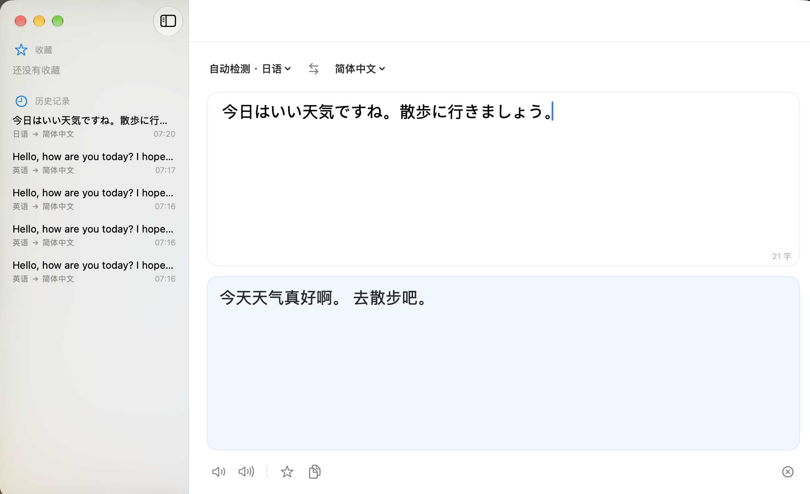

# 翻译

一个给 macOS 用的原生翻译 App。界面清爽，开箱即用，翻译全部在本地完成。



## 优点

**全系统组件**
界面用 SwiftUI，翻译走 Apple 自己的 Translation framework，朗读用系统语音合成，复制、存储、图标全部是系统原生能力。没有一行第三方依赖，没有 Electron，没有内嵌浏览器内核——打开就是原生 macOS 的手感，系统更新也跟着一起变好。

**足够省电**
空闲时 CPU 占用 **0.0%**——不轮询、不定时器、不后台刷新，放着不用它就真的什么都不做。翻译一条 130 字符的句子，总共只花掉大约 **0.2 秒** CPU 时间，翻完立刻回到零。笔记本上开着它一整天，风扇不会因为它转起来。

**内存很轻**
真实内存占用（private footprint）**38 MB**，翻译过后约 44 MB，之后稳定不再上涨。不是任务管理器里那个 100 MB 的数字——那里面包含了和全系统共享的框架页面，不算这个 App 自己的账。

**完全离线**
翻译在本机 Apple 芯片上完成，不联网、不上传、不等服务器。断网、飞行模式、地铁里，一样能用。你翻的内容不会离开这台电脑。

**自动检测语言**
不用告诉它这是什么语言，黏贴进去就开始翻。检测结果实时显示在顶部，一眼看得见。

**边打边翻**
输入停顿 450 毫秒就自动翻译，不用按任何键。想手动也可以，⌘↩ 随时触发。

**该有的都有**
收藏喜欢的句子、翻过的历史自动留在本地（默认保存最近 120 条）、原文译文都能朗读、一键交换语言、一键复制译文、字数统计、深浅色跟随系统。

## 快捷键

| 操作 | 快捷键 |
| --- | --- |
| 翻译 | ⌘ ↩ |
| 交换语言 | ⇧ ⌘ S |
| 收藏当前译文 | ⌘ D |
| 清空 | ⌘ ⌫ |

## 系统要求

macOS 26 或更高版本，Apple 芯片。

第一次翻译某种语言时，系统会问你要不要下载对应的语言包——点一下「下载」就行，之后永远不用再管。

## 构建

```bash
xcodebuild -project Translate.xcodeproj -target Translate -configuration Release \
  SYMROOT="$PWD/build" OBJROOT="$PWD/build/obj" build
```

产物在 `build/Release/翻译.app`，直接拖进「应用程序」文件夹就能用。
